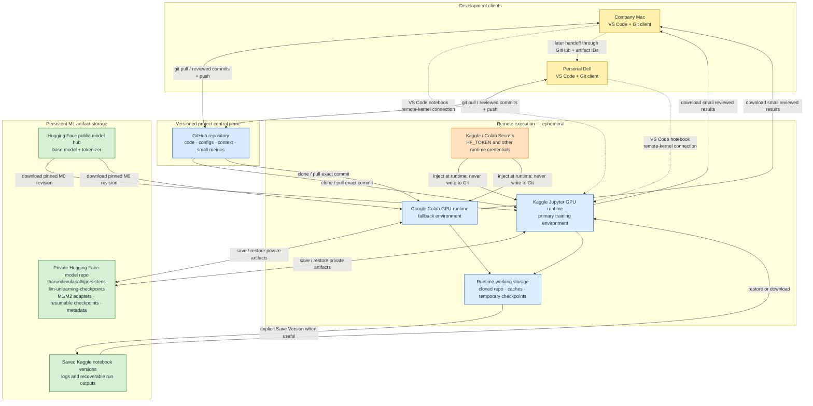

# Persistent LLM Unlearning — RAFG & RASP

M.Tech major-project research workspace for studying whether **targeted knowledge unlearning stays effective during later legitimate reasoning fine-tuning**.

**Current state:** Project proposals and common experimental plan. No experimental gains or completed training checkpoints are claimed here.

## The two candidate approaches

| Method | Strategy | Basic idea |
|---|---|---|
| **RAFG** — Reasoning-Aware Forgetting Guard | **Reactive** | Monitor whether designated forgotten answers become easier to predict; trigger short corrective forgetting updates only when necessary. |
| **RASP** — Retain-Aware Selective Plasticity | **Preventive** | Estimate which LoRA modules are sensitive to forget targets relative to retain targets; constrain those modules while allowing others to learn. |

Both test **post-unlearning safeguards**. Neither is proposed as a novel base-model architecture or a new original machine unlearning algorithm.

## Shared workflow

```text
M0 (base model)
 └── Supervised fine-tuning on invented facts
       ↓
M1 (learned fictional facts)
 └── Existing Gradient Difference unlearning
       ↓
M2 (canonical post-unlearning checkpoint)
 ├── No-protection fine-tuning: demonstrate/measure recovery
 ├── RAFG fine-tuning: monitor and correct when triggered
 └── RASP fine-tuning: score modules and selectively regularize
```

**Important:** Save one validated M2 checkpoint and start every continuation branch from an identical independent copy. Demonstrate an ordinary recovery challenge before claiming either safeguard is effective.

## Repository layout

```text
persistent-llm-unlearning/
├── context/
│   ├── PROJECT.md      # Research problem, methods, data and metrics
│   ├── DECISIONS.md    # Confirmed choices versus proposals
│   ├── STATUS.md       # Current stage, open gates and next steps
│   └── WORK_LOG.md     # Dated planning/experiment evidence
├── docs/
│   ├── data/
│   │   └── DATASET_SPEC.md
│   └── proposals/
│       ├── RAFG.pdf
│       └── RASP_Project_Guide.pdf
├── src/                # Reusable data/training/evaluation code (future)
├── experiments/        # Experiment configs/notebooks (future)
├── references/         # Notes and related-work references (future)
├── AGENTS.md           # Instructions for coding assistants
├── .gitignore
└── README.md
```

## Development, execution and storage architecture

The Mac and future Dell are development clients, not training machines. Source code and project memory move through GitHub; GPU work runs on Kaggle, with Colab as a fallback; durable model artifacts live in the private Hugging Face model repository `tharundevulapalli/persistent-llm-unlearning-checkpoints`.



### What is stored where

| Location | Store here | Do not store here | Access direction |
|---|---|---|---|
| **GitHub repository** | `src/`, experiment configs, notebooks, deterministic data-generation code, context files, small manifests, metrics and plots | Secrets, access tokens, base-model weights, large checkpoints or caches | Mac/Dell push reviewed changes; Kaggle/Colab pull an exact commit |
| **Kaggle or Colab runtime** | Active clone, downloaded model cache, generated working data and temporary checkpoints | The only copy of any important result | Runtime reads GitHub/Hugging Face; important outputs must leave the runtime before shutdown |
| **Private Hugging Face model repository** | M1 adapter, canonical M2 adapter, resumable adapter checkpoints, tokenizer additions if any, run metadata and checksums | Source-of-truth project documentation or unreviewed secrets | Kaggle/Colab upload after milestones and download to resume; Mac/Dell may verify or download |
| **Saved Kaggle notebook output** | Versioned logs and run outputs useful for recovery or audit | Sole canonical M1/M2 copy | Kaggle creates a saved version; later sessions can attach or download it |
| **Mac / Dell** | Working Git clone and optional downloaded backup | Sole copy of project memory or checkpoints | Synchronize through GitHub and the private artifact repository |
| **Kaggle / Colab Secrets** | Narrowly scoped `HF_TOKEN` and any required private-repository credential | Tokens in notebook cells, scripts, logs or Git | Credentials are injected into the runtime only when needed |

### Run lifecycle and access rules

1. In VS Code, pull `main`, read `AGENTS.md` and `context/`, then make and review source/config changes.
2. Commit and push the reproducible code state to GitHub. A run must record the exact Git commit SHA.
3. Start a Kaggle GPU session and connect the local VS Code notebook to its remote Jupyter kernel, or use Colab as the fallback.
4. In the runtime, clone/pull the recorded Git commit and download the pinned base-model revision from Hugging Face.
5. Read private credentials only from the platform secret store. Use a narrowly scoped token and never print it.
6. Run the experiment. Treat runtime disk as disposable even when a platform offers saved outputs.
7. At a verified milestone, upload the adapter/checkpoint and metadata to the private Hugging Face repository. M2 is not considered saved until it can be restored in a fresh session.
8. Bring small metrics, plots and logs back for review; update `STATUS.md`, `WORK_LOG.md` and, when needed, `DECISIONS.md`; then commit and push those records.
9. During the Dell handoff, clone GitHub and restore artifacts by their recorded Hugging Face repository path, revision and checksum. No dependency on the company Mac should remain.

The runtime may access the public base model without a write credential. Access to the private artifact repository requires a private token stored in the runtime's secret manager. Kaggle/Colab should not push project changes directly to GitHub in the normal workflow; changes return through the reviewed local working copy.

**Verified storage check (2026-11-04):** A committed Kaggle notebook version retrieved the repository-scoped `HF_TOKEN` from Kaggle Secrets, authenticated as `tharundevulapalli`, uploaded `storage-tests/kaggle-roundtrip.txt` to the private model repository, downloaded it, and confirmed a matching SHA-256 checksum. The upload produced Hugging Face artifact commit `8748fe1ff0eea0f45e79a47a990d96ae9c6bc086`. The token itself is not stored in this repository. The same restore check must be applied to the first real adapter.

## Starting stack (provisional)

- **Model:** [`Qwen/Qwen3-0.6B`](https://huggingface.co/Qwen/Qwen3-0.6B)
- **Training:** PyTorch, Hugging Face Transformers, PEFT/LoRA, Accelerate, TRL, Datasets.
- **Pilot data:** seeded fictional author/book/prize relationships (proposal suggests ~120 entities: 30 forget, 90 retain).
- **Unlearning baseline:** Gradient Difference, balancing forget-answer loss against retain-answer loss.
- **Editor:** VS Code; **compute:** Kaggle GPU as primary, Colab GPU as fallback.
- **Budget:** aim for zero paid LLM API calls.

These are working choices, not final benchmark settings. Pin dependency versions after the first successful smoke test.

### M0 smoke-test evidence

The interactive and fresh committed M0 runs passed on 2026-11-04 using a Kaggle T4 x2 runtime. The committed run loaded `Qwen/Qwen3-0.6B` at immutable revision `c1899de289a04d12100db370d81485cdf75e47ca`, applied the tokenizer chat template in non-thinking mode and produced the response `The model loaded successfully.` No training occurred. See `experiments/runs/m0_smoke_20261104/` for both structured results. The M0 environment/model-loading stage gate is complete.

## What counts as success?

At minimum, M1 must learn the facts, M2 must suppress designated targets without destroying useful ability, and a later unprotected fine-tuning run must provide an honest recovery measurement. Then compare RAFG/RASP with tuned baselines on seven planned metrics: direct/multi-hop forget accuracy, visible reasoning-trace leakage (where available), recovery rate, retain accuracy, new-task reasoning accuracy and computational overhead.

The main comparison is **forgetting stability versus useful new-task learning versus cost**, not suppression alone. All conclusions must be supported by logged tests. Observed suppression does not certify deletion from weights.

## Dataset design

The synthetic relational dataset is specified in [`docs/data/DATASET_SPEC.md`](docs/data/DATASET_SPEC.md). The design freezes the knowledge-unit graph, entity-first `F`/`R`/`N` split procedure, held-out `T` evaluation boundary, prompt-use partitions, leakage checks, manifests and pre-training acceptance gate. The generator and validators are implemented and tiny-tested; no accepted full pilot dataset has been generated.

CPU-only implementation checks:

```bash
python3 -m unittest discover -s tests -v

python3 -m src.data.generate \
  --config configs/data/pilot_v1.json \
  --output-dir /tmp/persistent-unlearning-tiny \
  --tiny

python3 -m src.data.validate /tmp/persistent-unlearning-tiny

python3 -m src.data.token_budget \
  /tmp/persistent-unlearning-tiny \
  --config configs/data/pilot_v1.json \
  --output /tmp/persistent-unlearning-token-budget.json
```

The tokenizer audit requires `requirements/data-audit.txt`. The verified tiny audit used the immutable Qwen tokenizer revision and measured 636 `N_rel` versus 648 `N_reason` tokens (1.89% difference, within the 5% tolerance). Automatic normalized-surface similarity checks reject author/book/prize pairs at or above `0.92`. Do not run the full pilot command until the remaining manual review is approved.

## What to do next

1. Review [`context/STATUS.md`](context/STATUS.md) and [`context/DECISIONS.md`](context/DECISIONS.md).
2. Create/verify the environment and smoke-test model loading on the chosen GPU.
3. Review the dataset specification, resolve its explicitly pending pilot choices, then write a reproducible synthetic data generator and validators.
4. Build M0 → M1 supervised fine-tuning and verify learned facts.
5. Apply initial machine unlearning to produce canonical M2 and verify forget/retain balance.
6. Run undefended recovery, then begin independent RAFG/RASP branches.

## Continuity and storage

Code/configs belong in version control. Save large model checkpoints/adapters and per-run artifacts in persistent personal storage; free notebook runtimes are temporary. Record base-model revision, adapter lineage, dataset checksums, configs and seed. Restore the repository and critical checkpoints on the personal Dell before returning the office MacBook. Follow office-device policies and never include employer data or credentials.

## Source documents

The proposal PDFs in `docs/proposals/` contain the full idea explanations, proposed formulas, implementation plans and references. Treat those documents as research proposals, not as proof that the methods work.
